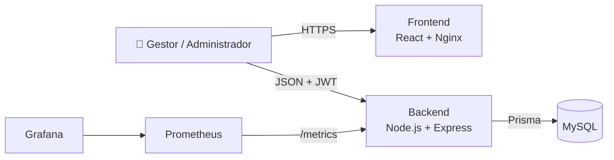

# EventosPro

**Sistema web de gestão de serviços e planejamento operacional de eventos para empresas de buffet.**

[](https://github.com/eduardaramalho/buffet-management-system/actions/workflows/ci.yml)
[](https://sonarcloud.io/project/overview?id=eduardaramalho_buffet-management-system)
[](https://sonarcloud.io/project/overview?id=eduardaramalho_buffet-management-system)

Projeto de Portfólio (TCC) do curso de Engenharia de Software da **Universidade Católica de Santa Catarina**.

📚 **Documentação completa na [Wiki do projeto](https://github.com/eduardaramalho/buffet-management-system/wiki)**

---

## Sobre

Em empresas de buffet de pequeno e médio porte, o planejamento de cada evento costuma depender de planilhas, anotações e da memória de quem já fez eventos parecidos. O resultado são tarefas esquecidas, atrasos e retrabalho.

O EventosPro centraliza clientes, eventos, serviços contratados, equipes e tarefas em uma única plataforma. O diferencial é um **motor de regras de negócio condicionais**: o gestor cadastra regras como *"casamento com mais de 150 convidados e serviço de bar exige uma equipe de bar e estas tarefas"*, e, ao confirmar o evento, o sistema gera as tarefas com prazos calculados e aloca automaticamente as equipes disponíveis.

> O motor usa lógica condicional estruturada e determinística. Não há inteligência artificial nem aprendizado de máquina.

## Funcionalidades

- **Clientes:** pessoa física ou jurídica, com validação de CPF e CNPJ (inclusive o CNPJ alfanumérico).
- **Catálogo de serviços:** cadastro dos serviços contratáveis com nome único e o item genérico "Outro" com rótulo livre.
- **Eventos:** serviços contratados, ciclo de vida com transições validadas (Planejamento, Confirmado, Em andamento, Concluído, Cancelado) e replicação de um evento anterior como base de um novo, com revisão dos itens copiados e rastreabilidade da origem.
- **Equipes e colaboradores:** equipes por especialidade, líder, alocação em eventos com detecção de conflito de agenda.
- **Motor de regras:** condições por tipo de evento, número de convidados e serviços; geração idempotente de tarefas; alocação automática de equipes e atribuição de cada tarefa à equipe responsável; alertas de falta de equipe.
- **Gestão operacional:** quadro de tarefas, tarefas manuais, atualização de status e Central do evento com atualização automática.
- **Dashboard e relatórios:** indicadores do gestor e relatórios de eventos, tarefas e desempenho das equipes, com exportação em CSV e PDF.
- **Acesso:** autenticação JWT com refresh token rotacionado, RBAC por permissões e trilha de auditoria.

## Stack

| Camada | Tecnologias |
|---|---|
| Frontend | React 19, TypeScript, Vite, React Router, Axios |
| Backend | Node.js 24, Express 5, TypeScript, Prisma 7, Zod, Pino |
| Banco de dados | MySQL 8 |
| Testes | Jest, Supertest, Vitest, Testing Library, Playwright |
| DevOps | Docker, Docker Compose, GitHub Actions, SonarCloud |
| Observabilidade | Prometheus, Grafana |

## Arquitetura

Monólito modular cliente-servidor. A API REST (`/api/v1`) segue Clean Architecture em cada módulo (domínio, aplicação, infraestrutura e apresentação), com Repository Pattern, Service Layer, DTOs validados com Zod e injeção de dependências pelo construtor.



Diagramas C4, modelo de dados e decisões em [Arquitetura](https://github.com/eduardaramalho/buffet-management-system/wiki/Arquitetura), [Modelo de Dados](https://github.com/eduardaramalho/buffet-management-system/wiki/Modelo-de-Dados) e [ADRs](docs/adr).

## Como executar

Pré-requisito: Docker com Docker Compose.

```bash
git clone https://github.com/eduardaramalho/buffet-management-system.git
cd buffet-management-system
cp .env.example .env      # troque os segredos e senhas
docker compose up --build -d
```

Na primeira execução o backend aplica as migrations automaticamente. Em seguida, crie permissões, papéis e o usuário administrador seguindo a seção de seed em [Como Rodar](https://github.com/eduardaramalho/buffet-management-system/wiki/Como-Rodar).

| Serviço | Endereço |
|---|---|
| Aplicação | http://localhost:8080 |
| API | http://localhost:3000/api/v1 |
| Health check | http://localhost:3000/api/v1/health |
| Prometheus | http://localhost:9090 |
| Grafana | http://localhost:3001 |

Para rodar em modo de desenvolvimento (sem contêineres para backend e frontend), veja [Como Rodar](https://github.com/eduardaramalho/buffet-management-system/wiki/Como-Rodar).

## Testes

```bash
cd apps/backend  && npm run test:coverage   # unitários e integração
cd apps/frontend && npm run test:coverage   # componentes e páginas
cd apps/e2e      && npm test                # jornada completa no navegador (requer MySQL)
```

| Suíte | Testes | Linhas | Branches | Funções | Statements | Mínimo exigido | Threshold do CI |
|---|---|---|---|---|---|---|---|
| Backend | 507 | 97,1% | 90,0% | 92,1% | 95,6% | 75% | 85% nas quatro métricas |
| Frontend | 269 | 94,9% | 82,1% | 84,7% | 87,7% | 25% | 80% nas quatro métricas |
| E2E | jornada com 14 passos | não se aplica | | | | | |

Medição de 22/10/2026. Cada execução do CI publica a cobertura de cada aplicação no resumo do job. As exclusões de cobertura e os thresholds seguem o [ADR 0007](docs/adr/0007-politica-de-qualidade-e-cobertura.md). Detalhes em [Qualidade e Testes](https://github.com/eduardaramalho/buffet-management-system/wiki/Qualidade-e-Testes).

## Estrutura do repositório

```
buffet-management-system/
├── apps/
│   ├── backend/        # API REST, Prisma (schema, migrations, seed), Dockerfile
│   ├── frontend/       # SPA React, Dockerfile, nginx.conf
│   └── e2e/            # testes end-to-end com Playwright
├── docs/adr/           # Architecture Decision Records
├── observability/      # Prometheus e provisionamento do Grafana
├── .github/workflows/  # pipeline de CI
└── docker-compose.yml
```

## Documentação

| Tema | Onde |
|---|---|
| Requisitos, histórias de usuário e casos de uso | [Wiki: Requisitos](https://github.com/eduardaramalho/buffet-management-system/wiki/Requisitos) |
| Arquitetura (C4) e motor de regras | [Wiki: Arquitetura](https://github.com/eduardaramalho/buffet-management-system/wiki/Arquitetura) |
| API | [Wiki: API](https://github.com/eduardaramalho/buffet-management-system/wiki/API) e [README do backend](apps/backend/README.md) |
| Segurança e LGPD | [Wiki: Segurança e LGPD](https://github.com/eduardaramalho/buffet-management-system/wiki/Seguranca-e-LGPD) |
| Deploy | [Wiki: Deploy](https://github.com/eduardaramalho/buffet-management-system/wiki/Deploy) |
| Decisões de arquitetura | [docs/adr](docs/adr) |
| Proposta original (RFC) | [portfolio_buffet](https://github.com/eduardaramalho/portfolio_buffet) |

## Autora

**Eduarda Cristina Nunes da Silveira Ramalho**
Engenharia de Software, Universidade Católica de Santa Catarina
[eduarda.ramalho@catolicasc.edu.br](mailto:eduarda.ramalho@catolicasc.edu.br)
