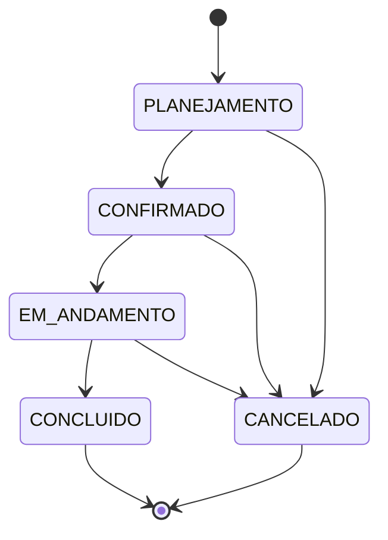

# ADR 0001: Serviços contratados e ciclo de vida do evento

- **Status:** Aceito
- **Data:** 2026-09-07
- **Escopo:** Módulo Eventos

## Contexto

O formulário de eventos permite selecionar vários serviços contratados e também informar um rótulo quando a opção genérica `Outro` é selecionada. O evento possui um ciclo de vida operacional que precisa ser validado no backend, independentemente da interface.

## Decisões

### Serviços contratados como catálogo relacional N:N

`Service` será um catálogo persistido e reutilizável. A relação entre eventos e serviços será feita por `EventService`, com chave composta (`eventId`, `serviceId`) e `customLabel` opcional.

Escolhemos esse modelo em vez de um campo livre ou enum porque ele permite reutilização, relatórios futuros sobre os serviços mais contratados e o cadastro de novos serviços pelo gestor sem novo deploy. O item genérico `Outro` é uma entrada única do catálogo (`isCustom = true`); nesse caso, `customLabel` é obrigatório. Para os demais serviços, `customLabel` não é permitido.

### Transições de status

O status inicial é `PLANEJAMENTO`. As únicas transições permitidas são:

- `PLANEJAMENTO -> CONFIRMADO`
- `PLANEJAMENTO -> CANCELADO`
- `CONFIRMADO -> EM_ANDAMENTO`
- `CONFIRMADO -> CANCELADO`
- `EM_ANDAMENTO -> CONCLUIDO`
- `EM_ANDAMENTO -> CANCELADO`

`CONCLUIDO` e `CANCELADO` são estados terminais. A matriz é uma regra do domínio e deve ser validada no `EventManagementService`, não apenas no frontend.

## Consequências

- O catálogo pode crescer sem alterar o schema de tipos de evento.
- A tabela de junção sustenta consultas e relatórios por serviço.
- Alterações de status inválidas são rejeitadas no backend.
- Estados terminais não podem ser reabertos por edição comum.
- A inclusão de novos status ou transições exige revisão deste ADR e dos testes do domínio.
